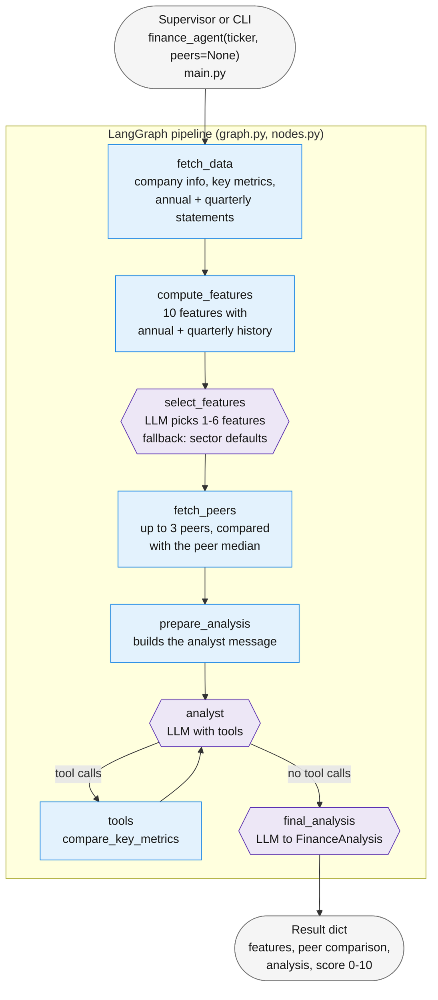

# Finance agent

The finance agent analyses a company's **financial numbers and valuation** using data from yfinance, and compares it with similar companies. It complements the economic agent:

| | Economic agent (`src/economic_agent`) | Finance agent (`src/finance`) |
|---|---|---|
| Source | Text of the latest SEC 10-Q / 10-K | yfinance statements and market data |
| Question | What does the report say about the business? | How strong are the numbers, and how is the company valued compared with its peers? |
| Score | `outlook_score` 0-10 | `financial_score` 0-10 |

The main design rule is that **code fetches and calculates, and the LLM interprets**. Every number the LLM sees is computed in Python, so the LLM never does arithmetic of its own.

## Usage

Run from the repository root:

```bash
python -m src.finance.main AAPL
python -m src.finance.main JPM --peers BAC WFC C
```

The supervisor runs it through `gather_research_data` in `src/supervisor/research.py`, in parallel with the news and economic agents. From other code, use the LangChain tool:

```python
from src.finance.main import finance_agent

result = finance_agent.invoke({"ticker": "MCD"})
result["financial_score"], result["summary"]
```

You need `IDUN_API_KEY` in `.env`. A run takes about 1-1.5 minutes, mostly for the yfinance downloads and the three LLM calls.

## Architecture

The diagram source is [architecture.mmd](architecture.mmd).



Hexagons are LLM steps; rectangles are plain code. The `.mmd` file also shows which module and external source each node uses.

### The nodes

| Node | LLM? | What it does | Writes to state |
|---|---|---|---|
| `fetch_data` | No | Downloads company info, key metrics and the needed statement rows from yfinance. Raises `ValueError` for an unknown ticker. | `ticker`, `company_info`, `key_metrics`, `statements` |
| `compute_features` | No | Computes the 10 features for every annual period and every quarter. | `features`, `features_period`, `feature_history`, `quarterly_feature_history` |
| `select_features` | Yes | Chooses the 1-6 features that matter most for this kind of company. | `selected_features`, `feature_reasoning` |
| `fetch_peers` | No | Finds up to 3 peers (or uses the given ones), computes their features and compares them with the peer median. | `peers`, `peer_data`, `peer_comparison_data` |
| `prepare_analysis` | No | Puts key metrics, selected features, reasoning and peer comparison into one message. | `messages` |
| `analyst` ⇄ `tools` | Yes | Writes the analysis. It can call `compare_key_metrics` for a competitor that isn't among the peers. | `messages` |
| `final_analysis` | Yes | Turns the analysis into a structured `FinanceAnalysis` with a score. | the `FinanceAnalysis` fields |

## Files

| File | Contents |
|---|---|
| `main.py` | The `finance_agent` LangChain tool and the CLI. It imports the graph lazily, so registering the tool doesn't start the LLM. It leaves the large intermediate data (`messages`, `statements`, `peer_data`) out of the result. |
| `graph.py` | Builds and compiles the LangGraph graph. |
| `nodes.py` | One function per node, plus `route_after_agent`. |
| `state.py` | `FinanceState`, all fields passed between nodes. |
| `data_fetcher.py` | yfinance access: `fetch_company_info`, `fetch_key_metrics`, `fetch_statements`, `fetch_financial_data`. `STATEMENT_ROWS` lists the statement rows that are kept. |
| `features.py` | Feature calculation, units, sector defaults and the fallback for selection. |
| `peers.py` | Peer search via `sp500.csv`, fetching peer data, and comparison with the median. |
| `tools.py` | Tools the analyst LLM may call (`compare_key_metrics`). |
| `llm.py` | The model (`FLASH_MODEL_NAME` from `src/model.py`, DeepSeek on IDUN, temperature 0), the model with tools, and the two structured-output models. |
| `prompts.py` | `ANALYST_PROMPT`, `FEATURE_SELECTION_PROMPT`, `FINAL_ANALYSIS_PROMPT`. |
| `schemas.py` | `FinancialFeature`, `FeatureSelection`, `FinanceAnalysis`. |
| `architecture.mmd` | The architecture diagram. |

## Features

All features are computed from the statements in `features.py`. `features` holds the latest **fiscal year**. The histories hold every year and every quarter.

| Feature | Formula | Unit |
|---|---|---|
| `revenue_growth` | Total Revenue vs previous period | % |
| `earnings_growth` | Net Income vs previous period | % |
| `gross_margin` | Gross Profit / Total Revenue | % |
| `operating_margin` | Operating Income / Total Revenue | % |
| `net_margin` | Net Income / Total Revenue | % |
| `return_on_equity` | Net Income / ending Stockholders Equity | % |
| `debt_to_equity` | Total Debt / Stockholders Equity | ratio |
| `current_ratio` | Current Assets / Current Liabilities | ratio |
| `free_cash_flow` | Free Cash Flow, or Operating Cash Flow + Capital Expenditure | currency |
| `free_cash_flow_margin` | Free cash flow / Total Revenue | % |

Edge cases:
- **Missing rows.** If a company doesn't report a row (banks have no gross profit or current assets), the feature is `None` and the selector can't choose it.
- **Negative equity** (MCD, for example). ROE and debt-to-equity are `None` instead of misleading numbers.
- **A missing latest year.** An older value is never presented as the current one.
- **Quarterly growth** compares with the same quarter one year earlier, so it needs 5 quarters and usually only exists for the latest quarter. Quarterly ROE and free cash flow are for a single quarter and aren't annualised.

## Feature selection

All features are computed every time, and **only afterwards** does the LLM choose which ones matter. The selector sees the sector, industry and the features that have a value. It returns `FeatureSelection` (features + reasoning).

Some features mislead for certain sectors. A bank's free cash flow can be −$148B, which says nothing about its health, and for utilities a high debt-to-equity is normal.

Safety rules in `select_features_node`:
1. Choices without a value, and duplicates, are removed. `Literal` can't change from company to company, so this has to happen in code.
2. If the LLM call fails or returns nothing usable, `default_features()` uses the sector's default list from `SECTOR_DEFAULT_FEATURES`.

The reasoning is passed on to the analyst and returned in the result.

## Peers

- **Given peers** (`--peers` or `peers=[...]`) are used as they are.
- **Without peers**, `find_peers` picks S&P 500 companies in the same GICS sub-industry (from `src/stockpicker_agent/sp500.csv`) that are closest in market cap, using `|log(cap_peer / cap_company)|`. Market caps are fetched in parallel.
- **Peers that fail to download** are skipped.
- **Companies alone in their sub-industry, or outside the S&P 500** (for example BRK.B), get no peers. The analyst can still use `compare_key_metrics`.

`peer_comparison_data` holds, for each key metric and selected feature, the company value, the peer median and the difference:
- **Key metrics:** difference in % of the peer median.
- **Features:** difference in the feature's own unit (for example percentage points for margins).

## Result

`finance_agent` returns a dict with:
- `ticker`, `company_info`, `key_metrics`
- the features and their history
- `selected_features`, `feature_reasoning`
- `peers`, `peer_comparison_data`
- the `FinanceAnalysis` fields: `summary`, `valuation_assessment`, `peer_comparison`, `key_trends`, `positive_factors`, `risk_factors`, `financial_score`, `score_reasoning`

## Known limitations and next steps

- **No cache.** Every call downloads everything again. The economic agent's `cache.py` could be copied, keyed on ticker + date.
- **`dividend_yield` from yfinance is already in percent** (0.31 = 0.31%), while `info` margins are fractions. The features don't use `info` margins.
- **Peer ranking uses market cap only.**
- **Regression (`finance_agent/utils/tools/regression`) isn't included.** One ticker has too few periods. It needs a separate dataset of many tickers × many quarters, which `features.py` can be reused to build.
- **Structured output uses `method="function_calling"`.** With the default `json_schema` method, DeepSeek on IDUN sometimes returned empty content.
